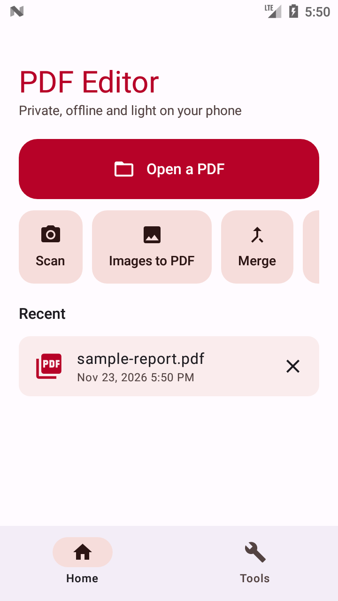
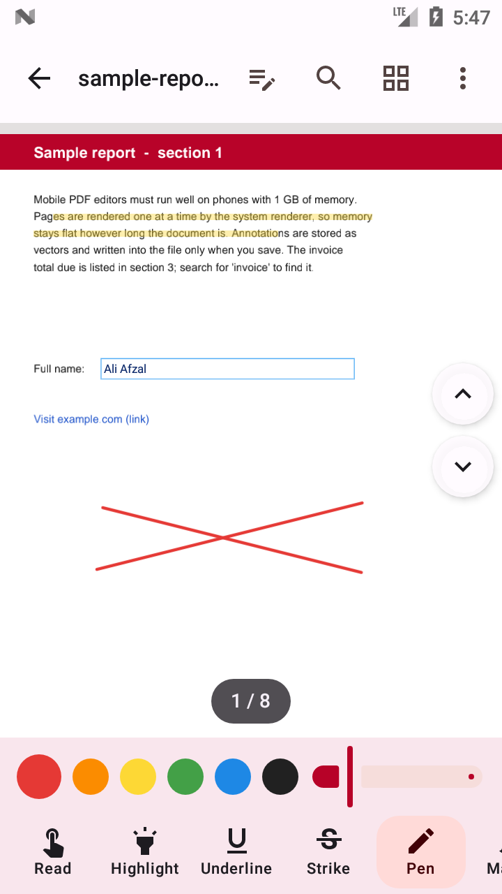
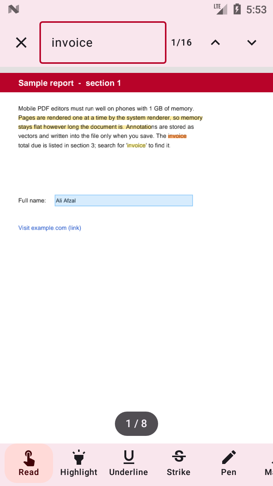
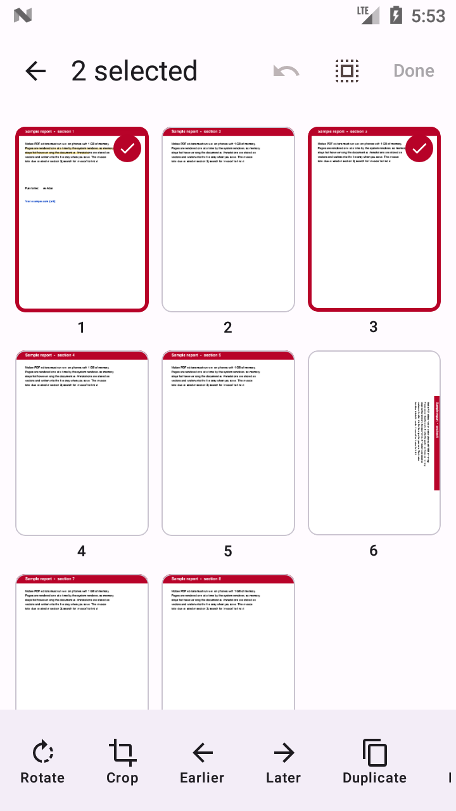
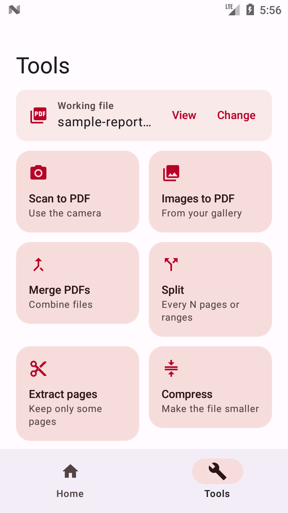

# Mobile PDF Editor (Android, low-end friendly)

An offline, private PDF reader and editor for Android 7+ phones with 1–2 GB of RAM. The feature set is
derived from [PdfCraft](https://github.com/storytold/pdfcraft); see [docs/FEATURES.md](docs/FEATURES.md)
for how its ~400 desktop features were triaged for mobile. No PdfCraft code is reused.

| Home | Annotate | Search | Organize | Tools |
|---|---|---|---|---|
|  |  |  |  |  |

## Status

Builds, passes 7 unit tests and the on-device suite, and has been used end to end on:

| Device | Android | Detected tier | Result |
|---|---|---|---|
| Emulator `lowend24` (1 GB RAM, 4 cores) | 7.0 | LOW | all flows; 120-page stress file |
| Samsung Galaxy A15 (SM-A155F, Helio G99, 8 GB) | 16 | HIGH | all device tests pass; open/annotate/fill/save/reopen, 120-page stress, kill-and-resume |

Release APK **3.3 MB** (R8, arm only). Min Android 7.0. No permissions.

### The app adapts to the phone by itself

At start-up it reads the phone's RAM, the per-app memory limit, CPU cores, Android's low-RAM flag and
the Android version, and picks a tier (logged under tag `DeviceBudget`):

| | LOW (1–2 GB, Android Go, old Android) | MID (3–4 GB) | HIGH (e.g. Galaxy A15) |
|---|---|---|---|
| Page cache | ≤ 12 MB | ≤ 32 MB | 1/32 of RAM, ≤ 192 MB |
| Sharpest page render | 1280 px | 1800 px | 3240 px |
| Max zoom | 3× | 4× | 6× |
| Pages rendered ahead | 0 | 1 | 2 |
| Scan resolution | 1600 px | 2000 px | 3000 px |

If Android reports low memory while the app is open, it steps down a tier for the session. When Android
kills it in the background (normal on budget phones, e.g. while the camera is open), it comes back to the
same document, page, unsaved annotations and scan pages.

Measured on the Galaxy A15, 120-page image-heavy PDF, flinging through it:
HIGH tier ~420 MB total PSS (mostly the page cache, by design); forced 1 GB mode peak 26 MB Java heap /
147 MB total allocations — inside the 1 GB-phone budget used by the meter (96 / 160 MB).

**Tester switch:** long-press the "PDF Editor" title on Home (or `adb shell am start -n
com.mobilepdf.editor/.MainActivity --ez lowend true`) to force the LOW tier with a live memory meter.
It copies a 1 GB phone's limits only: CPU speed and real out-of-memory kills cannot be simulated, so
check once on a real 1–2 GB phone before claiming budget-phone support.

## Features

- **Read**: smooth scrolling, pinch and double-tap zoom, **fit text width** (zooms so the text column, not the paper
  margins, fills the screen), find with highlighted hits, bookmarks, page jump,
  night mode, links (asks before opening URLs), rotated pages, password-protected files, damaged-file repair.
- **Edit text** (modelled on PdfCraft's design, `docs/editing-existing-text.md` in that repo): tap a line,
  retype it. The old glyphs are removed from the page content (no white box, nothing left underneath for
  copy/search), and the new text uses the line's own font, size, colour and baseline. Applied at once,
  undoable from the top bar. Empty text deletes the line. **Whole paragraph**: a line inside a paragraph
  can be edited together with its paragraph; the new text is re-wrapped to the paragraph's width at its own
  line spacing (lines in several fonts and LaTeX's per-line font stretching are handled). In Edit-text mode every editable piece of text is
  outlined in its font's colour (legend in the tool bar; dashed = OCR text); table cells and columns are
  separate pieces even in the same font. Letters a subset font lacks fall back one by one to a look-alike
  (serif / sans / mono, bold / italic); you can also pick Sans / Serif / Mono or an uploaded font.
- **OCR** (⋮ → Recognize text): on-device ML Kit adds an invisible text layer to scanned pages, so they can
  be searched, highlighted and edited (edits are painted on the paper's own colour in the ink colour).
- **Scanner** (CamScanner-style, ML Kit document scanner): edge detection, auto-capture, corner adjust,
  filters, clean-up, several pages, gallery import; scans are OCR'd automatically. Falls back to the camera.
- **Annotate**: highlight / underline / strike by dragging over the words, pen, marker, text, box, oval,
  line, arrow, eraser, hand-drawn signature (remembered), move / pinch-to-resize / delete, undo / redo in the
  top bar.
- **Redact** (PdfCraft's redaction, ported): mark words (drag over them), areas (drag a box) or let
  *Find & mark* mark words and patterns (e-mails, phone and card numbers, dates, IBANs, SSNs). *Apply*
  removes everything under the marks from the file, not just from view: text (the rest of the line keeps
  its place, OCR text included), images (only covered pixels), drawings, grouped content, links,
  comments and fields, plus metadata that repeats the removed words. Every page is re-read afterwards; a
  page that can't be redacted exactly becomes a picture of itself with the areas painted out. Undo until
  the file is closed; unapplied marks are never silently dropped on save.
- **Select & copy text**: long-press a word in Read mode, drag to extend or move the handles; Copy, Share,
  Highlight, Redact, All. Respects the author's copy permission.
- **Notes & comments**: sticky notes saved as real PDF comments; *Comments & changes* lists everything
  you added, to jump to or delete.
- **Insert picture** from the gallery: move and pinch-resize, saved as JPEG.
- **Digital signatures** (certificate-based, like Acrobat's): a signing key made in the phone's secure keystore
  or an imported .p12/.pfx; CMS/PKCS#7 detached, SHA-256, saved as an incremental update. Signed PDFs are
  checked when opened (valid / changed after signing / altered) — verified independently with OpenSSL.
- **Tick tool** (Fill & Sign): tap to place ✓, ✗ or ● on paper-style forms; drawn as shapes, so they look the
  same in every PDF app.
- **Read aloud**: the phone's text-to-speech reads from the current page on, scrolling along (pause/resume/stop).
- **Review shapes**: cloud (scalloped outline) and area highlight (works on scans and pictures).
- **Stamps**: APPROVED, PAID, CONFIDENTIAL, DRAFT, RECEIVED + today's date… or your own text and colour.
- **Edit bookmarks**: add one for the current page (named after the page's heading), rename, delete,
  reorder, nest; undoable.
- **Add text styling**: bold, italic, Sans / Serif / Mono, sizes, colours; an **eyedropper** copies font,
  weight, size and colour from any text on the page (saved with the PDF's very own font when it has the
  letters); **upload a font** (.ttf, embedded as a subset) and use it for new or edited text.
- **Sign**: draw with your finger, or use a photo of your signature on paper (paper removed automatically,
  remembered for next time); fits into signature fields.
- **Fill & sign forms**: tap a field on the page or fill every field from a list; text, checkbox, radio,
  dropdown, signature fields; optional flatten on save. Calculated fields work without a script engine:
  sums, averages, products, min/max and simple formulas (`Qty * Price`), in the form's own order and
  number format ($1,234.50, 1.234,50 €, 12.5%).
- **Organize pages**: rotate, reorder, duplicate, insert blank, insert pages from another PDF, delete, crop, extract.
- **Tools**: merge, split (ranges or every N), extract pages, compress, password-protect (AES-256,
  permissions), watermark, page numbers, scan / images to PDF (document filter), PDF to images,
  extract text, extract images, compare two PDFs (report of removed / added lines per page), attachments (list, save, attach a file), header & footer ({page},
  {pages}, {date}, {file}), remove hidden information (metadata, attachments, comments, form fields,
  hidden text, links/actions/JavaScript, bookmarks, private app data), document properties.
- **Safety**: works on a private copy; autosaves a recovery draft and offers to restore it after the app is
  killed; asks before closing with unsaved changes; respects the author's permissions (read-only mode).
- **Urdu (اردو)**: Settings → Language → اردو (or follow the phone). The interface turns right-to-left; PDF pages
  keep their own layout. Translations live in `ui/I18n.kt`, keyed by the English text, so new screens are
  covered by importing `com.mobilepdf.editor.ui.Text` instead of Material's.
- **Settings**: budget-phone mode, signing identity, saved signatures and fonts, clear temporary files,
  About with the open-source licences (PdfCraft MIT, PdfBox-Android Apache-2.0, …).
- Open from other apps ("Open with" / "Share"), save back to the original or save a copy, share, print.

## How it is built (and why)

| Decision | Reason |
|---|---|
| Kotlin + Jetpack Compose, no navigation/DI libraries | No second runtime; small APK |
| OS `PdfRenderer` for display | pdfium ships with Android: 0 KB, native speed, one page in memory at a time |
| PdfBox-Android for editing, loaded lazily in temp-file mode | Pure Java (Apache-2.0); big files spill to disk, not the heap |
| Bitmap cache and max render width sized from `memoryClass` | Same APK behaves on 1 GB and 8 GB phones |
| Annotations as normalized vectors, written into the PDF on save | Zoom-independent, cheap undo, crash-recovery drafts |
| System file picker and system camera | No permissions, no CameraX |

### Android quirks this app handles (found by testing on Android 7)

- Opening is fast on 1 GB phones: the document shows at once (a display copy, if older Androids need one,
  replaces it when ready), the font check runs after the page list and only locks the renderer for one small
  render, and signatures are only checked when the file contains a /ByteRange. A 142-page IRS publication
  shows its first page within 3 s on the Android 7 / 1 GB emulator (it took ~20 s before).

- Android 7's PdfRenderer draws no embedded Type 1 text (LaTeX papers render as blank pages; Android 16's
  does). On older Androids each document is probed (one text page drawn small, glyph positions checked for
  ink) and, if text is missing, drawn by PdfBox instead. PdfBox-Android itself had a bug there (each glyph
  drawn only once per page: the cached outline was transformed in place); `SafePDFRenderer` hands the drawer
  copies.

1. **The OS renderer segfaults on AES-256 PDFs** (pdfium in Android 7 dereferences null and kills the
   process instead of throwing). Encrypted files are detected by a byte scan while they are copied in and are
   decrypted with PdfBox first; the OS renderer never sees an encrypted file. Regression test:
   `PdfOpsTest.protectThenUnlock`.
2. **The OS renderer does not draw annotation appearances** (filled form fields, comments and stamps from
   other apps were invisible; measured: 0 pixels). A display-only copy with appearances drawn into the page is
   rendered instead. Test: `PdfOpsTest.formsReadFillFlatten`.
3. Drag gestures report their start only after the touch slop; the real touch-down point is used so
   strokes and text selection start under the finger.

## Code map

```
app/src/main/java/com/mobilepdf/editor/
  AppViewModel.kt         app state, open (decrypt/repair), save, drafts, background-op runner
  pdf/PageRenderer.kt     OS PdfRenderer wrapper + DeviceBudget (memory-aware limits)
  pdf/PdfOps.kt           merge / split / organize / crop / compress / protect / watermark / scan …
  pdf/AnnotBaker.kt       writes annotations into page content (rotation-aware)
  pdf/DocExtras.kt        forms (read/fill/flatten), bookmarks, links, page geometry
  pdf/PageText.kt         per-page text + character boxes (find, select by dragging)
  annot/Annot.kt          annotation model, hit-testing, move/scale
  data/                   recent files, saved signature, crash-recovery drafts
  ui/                     home, tools, organize, viewer (+ sheets), shared components
app/src/test              JVM unit tests (ranges, text selection, geometry, drafts, labels)
app/src/androidTest       on-device tests that create real PDFs and check output, incl. pixels
```

## Build, test, run

Toolchain used: JDK 17 (`~/tools/jdk`), Gradle 8.10.2 (`~/tools/gradle`), Android SDK platform 35.

```powershell
$env:JAVA_HOME = "$HOME\tools\jdk\jdk-17.0.21.1+2"
$gradle = "$HOME\tools\gradle\gradle-8.10.2\bin\gradle.bat"

& $gradle :app:assembleDebug                 # app/build/outputs/apk/debug/app-debug.apk
& $gradle :app:testDebugUnitTest             # JVM unit tests
& $gradle :app:connectedDebugAndroidTest     # on-device tests (emulator or phone connected)
& $gradle :app:assembleRelease               # 3.3 MB, arm only
& $gradle :app:assembleRelease -Pemulator    # release build that also runs on an x86 emulator
```

A low-end test emulator is set up as AVD `lowend24` (Android 7.0, 1 GB RAM, 720×1280):

```powershell
& "$HOME\AppData\Local\Android\Sdk\emulator\emulator.exe" -avd lowend24
```

**Before publishing:** the release build is signed with the debug key so it can be installed locally.
Create your own keystore and replace `signingConfig` in [app/build.gradle.kts](app/build.gradle.kts).

## Known limits / next steps

- Edit text works line by line (no paragraph reflow). Text inside grouped artwork (form XObjects) or drawn
  together with other lines is refused with a message instead of being half-edited.
- Uploaded fonts: TrueType outlines only (.ttf, or .otf with TrueType outlines); CFF-based .otf is refused.
  On screen, a font copied with the eyedropper is previewed with the system font of the same family/weight;
  the saved PDF uses the real font.
- Saved annotations become page content (visible everywhere, but not editable as comments in other apps).
- New text in standard fonts and watermarks support Latin text only; use an uploaded font for other scripts.
- Zoom re-renders the whole page up to a width cap (1280 px on low-RAM phones); no tiled deep zoom yet.
- Search shows progress on long documents (matches so far · page n/N).
- Not yet: paragraph reflow, text copy, comment replies, digital (certificate)
  signatures, localization. See [docs/FEATURES.md](docs/FEATURES.md).
